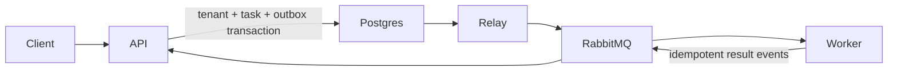

# Tenant Provisioning Control Plane

An asynchronous tenant lifecycle API built with FastAPI, PostgreSQL, and RabbitMQ. PostgreSQL is authoritative: API mutations atomically write the tenant, task, and transactional-outbox row; the relay publishes only committed outbox rows. Worker result events are deduplicated in an inbox table before status changes are committed.



## Run

Requirements: Docker Compose.

```bash
make up
curl -sS -X POST http://localhost:8000/v1/tenants \
  -H 'content-type: application/json' \
  -d '{"slug":"acme-prod","name":"Acme Production"}'
```

The API is at `http://localhost:8000`; RabbitMQ management is at `http://localhost:15672` (`guest` / `guest`). `make down` stops the stack and preserves the database volume.

Schema changes are applied by Alembic before the API starts. During local development, `make reset` explicitly removes the local PostgreSQL volume before rebuilding from a schema that predates the migration history.

Run checks and tests with:

```bash
make test
```

This runs Ruff lint/format verification, mypy, Bandit, and pytest in a clean API container. The tests use SQLite for focused domain/API coverage; the running Compose stack provides the PostgreSQL/RabbitMQ end-to-end workflow.

## Logging

Both the API and worker containers use structured JSON logging (in Docker mode) with comprehensive workflow tracking:

- **API Container**: Logs all HTTP requests/responses with tenant_id, task_id, status codes, and timestamps
- **Worker Container**: Logs task consumption, result publishing, task completion, and errors
- **Outbox Relay**: Logs event publishing attempts, successes, failures, and retry scheduling
- **Result Consumer**: Logs result event processing, idempotency checks, and dead-lettering
- **Services Layer**: Logs all domain operations (create, update, destroy, result application) with relevant IDs and state transitions

Log levels can be controlled via the `LOG_LEVEL` environment variable (default: INFO). In non-Docker environments, logs use a human-readable format; in Docker, they use JSON for better aggregation.

View logs in real-time:

```bash
# API logs
docker compose logs -f api

# Worker logs
docker compose logs -f worker

# All logs
docker compose logs -f
```

## API

- `POST /v1/tenants` creates a `provisioning` tenant and `deploy` task (`201`).
- `GET /v1/tenants`, `GET /v1/tenants/{id}` list/read tenants. `limit`, `offset`, and `status` are supported on the list.
- `PATCH /v1/tenants/{id}` requires `{ "name": "...", "version": N }`, accepts only active tenants, and creates an update task (`202`).
- `DELETE /v1/tenants/{id}` accepts active or failed tenants and creates a destroy task (`202`).
- `GET /v1/tasks`, `GET /v1/tasks/{id}` are read-only. Tasks can filter by `tenant_id`, `status`, and `type`.

All errors use `{ "error": { "code", "message", "details" } }`. Contractual codes include `tenant_not_found`, `tenant_already_exists`, `tenant_update_not_allowed`, `tenant_version_conflict`, and `task_not_found`.

The worker transitions each task `accepted → in_progress → done|failed`. Terminal results change the corresponding tenant and increment its version. PATCH uses a conditional `id + version + active` write, so two updates using one version cannot both succeed.

## Messaging and reliability

Task messages carry `id`, `type`, `tenant_id`, and `status`. Results carry stable `event_id`, `task_id`, `tenant_id`, and `status`. The consumer inserts the result ID into the inbox in the same transaction as task/tenant updates. Duplicate IDs, stale updates, and all updates after a terminal result are acknowledged as no-ops. Invalid/mismatched results are sent to `provisioning.dead-letter`; transient failures are negatively acknowledged for redelivery.

The outbox relay uses persistent RabbitMQ messages and only marks an event published after broker confirmation. Failed publishes retain the outbox record, record a sanitized error class, and retry with bounded exponential backoff. A crash in the confirmation gap can publish twice, which is intentional at-least-once behavior.

## Reproducible scenarios

Force future operations to fail by restarting the worker:

```bash
docker compose stop worker
docker compose run -d --name tenant-worker-failing worker python -m app.worker --fail-rate=1 --min-delay-ms=0 --max-delay-ms=0
```

Restore normal operation with `docker rm -f tenant-worker-failing && docker compose up -d worker`.

To test a stale/duplicate result, publish JSON to `provisioning.results` from the RabbitMQ UI or `rabbitmqadmin` container. Use the original `task_id`/`tenant_id`, an already-seen `event_id` for a duplicate, or `in_progress` after `done` for a stale event; neither regresses persisted state.

## Trade-offs

This intentionally keeps the relay and consumer as managed API-process threads for a compact deployable unit. They can be split into independently scaled processes without changing the transaction or message contract.
